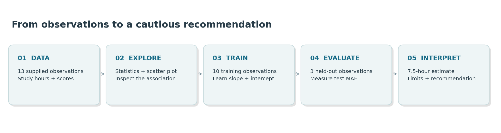
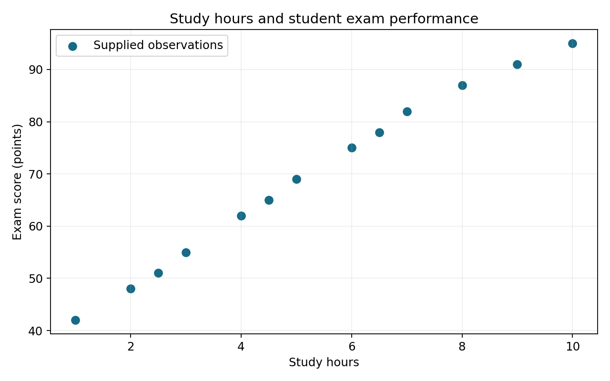
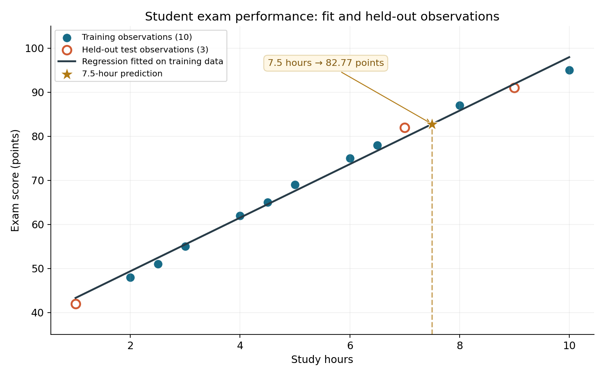
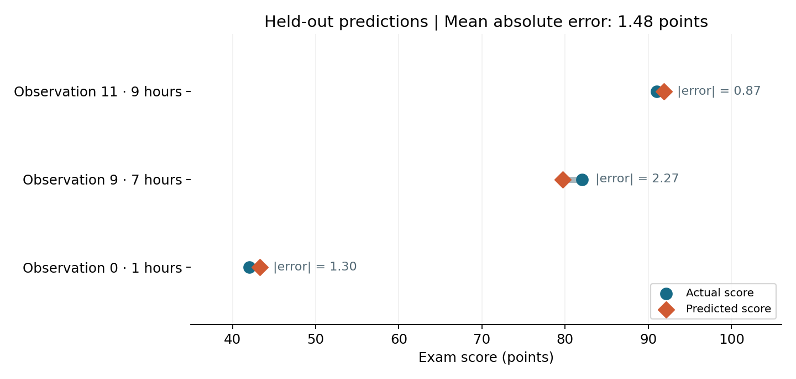

# Student Exam Performance Predictor

A proof of concept for the Academic Support Office. It uses the 13 supplied observations to examine the association between study hours and exam score, fit a linear regression on study hours alone, and state where a prediction should not be trusted.

## Results

The model is fit on 10 training observations and evaluated on 3 held-out observations (`test_size=0.2`, `random_state=42`).

- Predicted score = 37.2329 + 6.0713 × study hours.
- Test mean absolute error: 1.48 exam-score points.
- Estimate at 7.5 study hours: 82.77 points, inside the observed range of 1–10 hours.
- Output at 100 study hours: 644.36 points. That figure is an extrapolation and is not a usable prediction.

`AboveAverage` is calculated from the exam scores for description only. It is not a model input. The line is fit on the training rows. The test rows are used only to measure error.

## How to run

Python 3.9 with the versions in `requirements.txt`.

```bash
python3 -m venv .venv
source .venv/bin/activate
python -m pip install -r requirements.txt
python -m ipykernel install --user --name student-predictor --display-name "Student Predictor"
python -m notebook
```

Open `Student_Exam_Performance_Predictor.ipynb`, select the Student Predictor kernel, then use Restart Kernel and Run All. The notebook writes plots, `results.json`, and `test_predictions.csv` into `outputs/`.

```bash
python -m unittest discover -s tests -v
```

## Limits

Thirteen observations and one predictor cannot support a causal claim or a decision about an individual student. The error on three test rows is a demonstration, not a forecast of future error. A later version would need a larger sample and further measures such as attendance, prior grades, assignment performance, sleep, and course difficulty.

## Visual results









## Project files

- The notebook contains the complete seven-stage analysis and saved outputs.
- `outputs/` contains four figures, the test comparison CSV, and model results.
- `tests/test_project.py` replays the analysis and checks data, the split, model parameters, predictions, MAE, all four figures, and conclusion length.
- `.github/workflows/verify.yml` runs tests on pushes and pull requests.
- `demo/index.html` is a browser demonstration of the trained prediction equation. Open it directly; it needs no server, GPU, or package installation. It uses model parameters exported from the verified Python analysis.

The demonstration is an additional presentation tool. The executed notebook remains the assignment deliverable.
